# Case File 001: PCAP and OSINT Analysis of a Lumma Stealer Alert 📂

Source exercise: [Lumma in the Room-ah (2026-01-31)](https://www.malware-traffic-analysis.net/2026/01/31/index.html) on malware-traffic-analysis.net.
This repo contains my own analysis only. No PCAP and no malware are included, and all indicators are defanged.

## Summary📄

1. An IDS alert (ET MALWARE Lumma Stealer Victim Fingerprinting Activity) fired on 2026-01-27 at 23:05 UTC for traffic from 153[.]92[.]1[.]49 over TCP port 80 (HTTP).
2. In the associated PCAP, the only internal host talking to that IP was 10.1.21.58, identified as DESKTOP-ES9F3ML, logged in as `gwyatt` (Gabriel Wyatt) in the WIN11OFFICE domain.
3. A browser on the host loaded a page from whitepepper[.]su whose JavaScript collected browser and hardware details and posted them (about 8 KB) back to the server, which was consistent with the fingerprinting activity that triggered the alert.
4. The domain was 39 days old at the time and had used at least 9 different IPs since December 2025. VirusTotal lists 590 files that contact it, and ThreatFox lists URLs on it under Lumma Stealer.
5. Confidence: host identification is high. How the host was infected, and whether its malware matches the sample I studied, are not established by this capture.

## Tools and Terms🔨
 
Tools: Wireshark, VirusTotal, ThreatFox, URLhaus, crt.sh.
Every finding has a packet number or a source. 

Confidence labels: **Confirmed** (direct evidence), **Likely** (strong indirect evidence), **Inferred** (my reasoning, not proven).

## Phase 1: Triaging PCAP

| Question | Answer | Filter / method | Evidence | Confidence |
|---|---|---|---|---|
| Infected IP | 10.1.21.58 | `ip.addr == 153.92.1.49`, then Statistics -> Conversations -> IPv4 with "Limit to display filter" | Only internal host that talked to the alerted IP, at alert time (23:05 UTC) | Confirmed |
| MAC address | 00:21:5d:c8:0e:f2 | `dhcp` | DHCP Client MAC field, requested IP 10.1.21.58 | Confirmed |
| Hostname | DESKTOP-ES9F3ML | `dhcp` | DHCP option 12 (Host Name) | Confirmed |
| User account | gwyatt | `kerberos.CNameString` (added as a column) | Kerberos AS-REQ from 10.1.21.58 to the DC, starting at packet 214 and no trailing `$`, so a user account | Confirmed |
| Full name | Gabriel Wyatt | `samr`, then the DC's QueryUserInfo response | SAMR response, packet 28574, matches the `gwyatt` naming pattern | Confirmed |
| Alert domain | whitepepper[.]su | `ip.addr == 153.92.1.49 && http.request` | HTTP `Host:` header, packet 24500 | Confirmed |

### Evidence
 
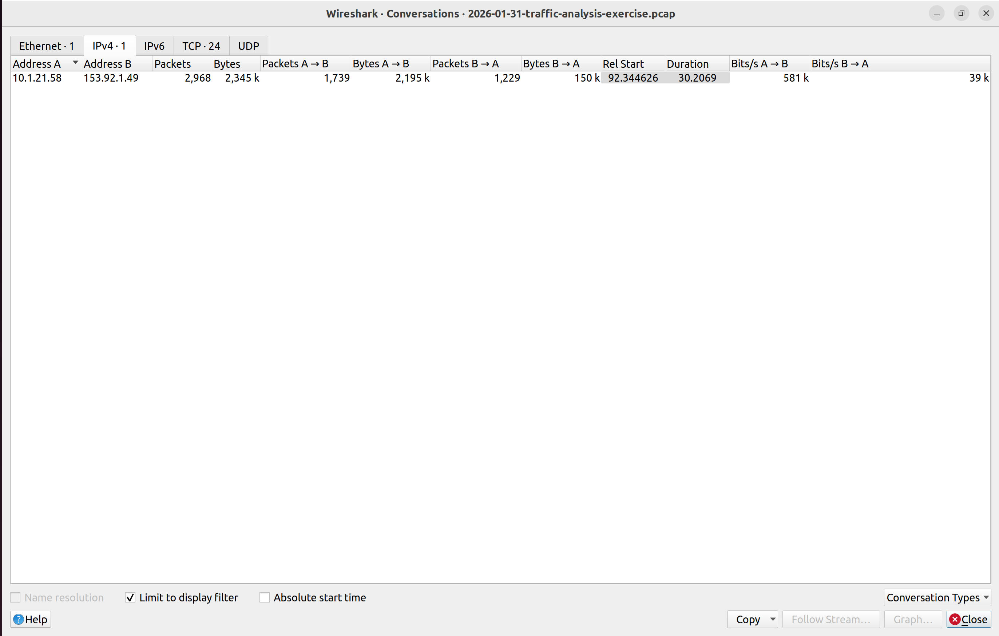
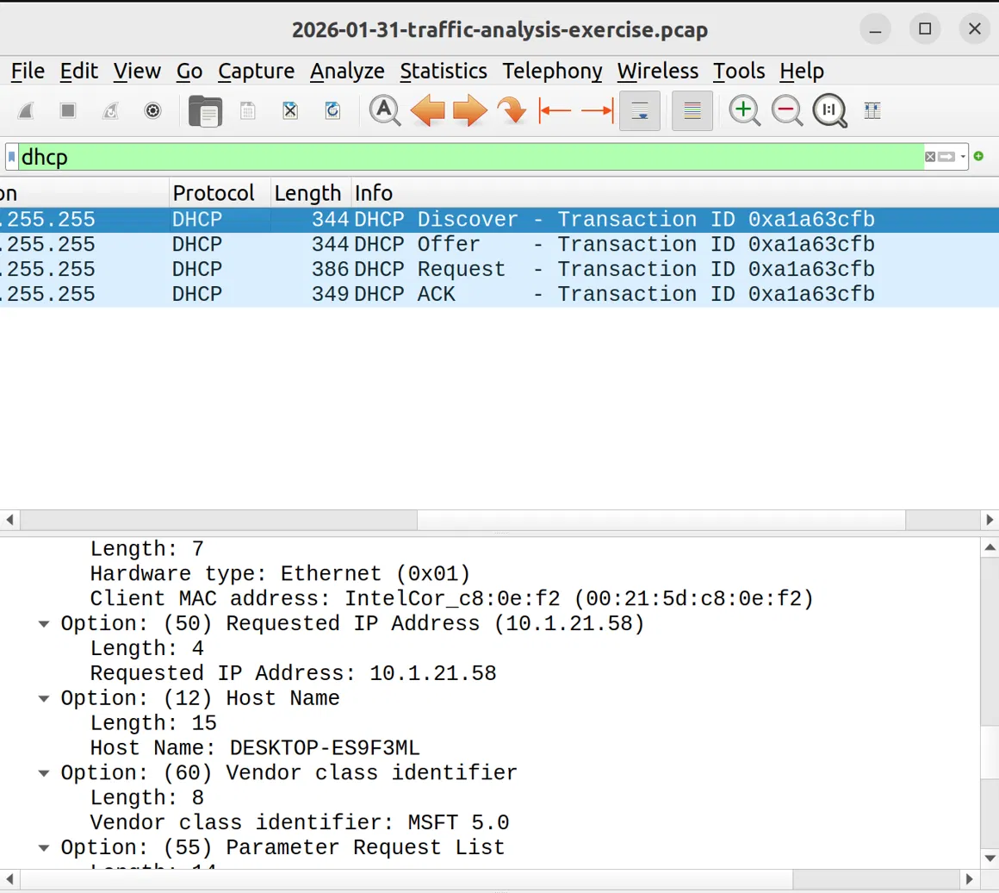
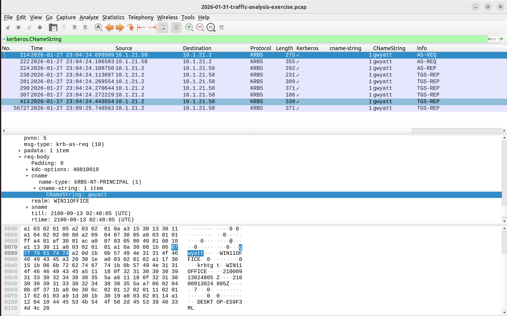
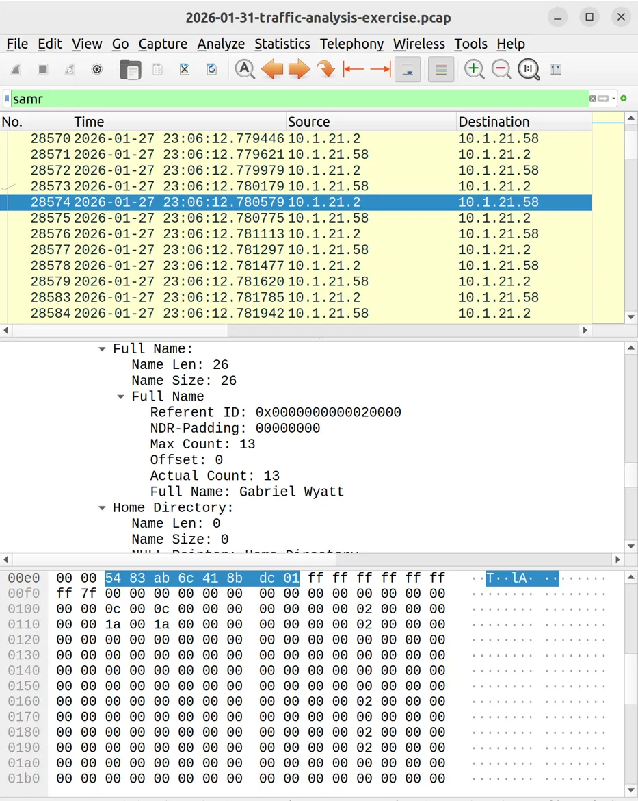
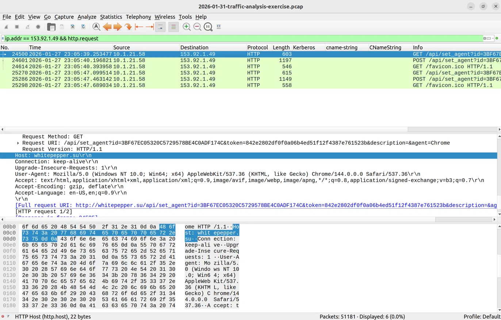

### The check-in requests
 
The host sent the same three-step pattern twice, about 8 seconds apart: packets 24500 / 24601 / 24614 and 25270 / 25286 / 25298. All six requests carry the same `id` and `token`.

| Step | Packet | What happened |
|---|---|---|
| 1 | 24500 | GET `/api/set_agent?id=<32 hex>&token=<hex>&description=&agent=Chrome` |
| 2 | 24525 | The server (nginx/1.29.1) replies `200 OK` with a minimal HTML page titled "test" that contains a JavaScript fingerprinting script |
| 3 | 24601 | The script POSTs about 8 KB of form data (Content-Length 8023) back to the same URL with `act=log` added; the server replies `200 OK` |
| 4 | 24614 | The browser requests `/favicon.ico`, and the script sends the page to `about:blank` |

**In plain terms:** the host's browser asked the server for a page. The server answered with a small program (JavaScript) that ran in the browser, collected details about the computer, and sent them back to the server.

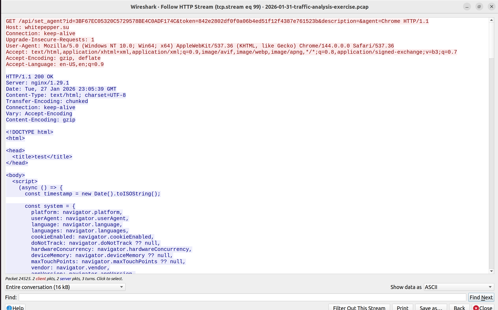

**What the script collected** (decoded from the POST body in packet 24601):
 
- OS and browser: platform `Win32`, Chrome 144, language `en-US`
- Hardware: 12 logical CPU threads, an AMD Radeon R9 200 Series GPU reported through WebGL (ANGLE / Direct3D11), a 1920x1080 screen with 24-bit color
- Other details: audio sample rate 48000 Hz, connection type "4g", the browser's built-in PDF viewer plugins, and `webdriver = false` (a flag that shows whether the browser is being automated)
- A canvas fingerprint (a small image the browser renders and the script sends back as base64)
- A hard-coded list of commonly used fonts

**My observations**

| Observation | Confidence |
|---|---|
| The `id` and `token` are already in the first GET, before the server's script ran, so they existed before the page loaded | Confirmed |
| The first GET has no `Referer` header, so the page was probably opened directly and not by clicking a link | Likely |
| The headers (`Upgrade-Insecure-Requests`, `Accept: text/html...`) match normal Chrome page navigation, so a browser on the host loaded the page and not a standalone program | Likely |
| The purpose is to identify the machine and tell real victims from analysis environments | Inferred |
| The script looks unfinished as it has a `TODO` comment, a hard-coded font list, and it never waits for the WebRTC result, which explains the empty field | Inferred |
| What launched the request (a link, or something else) | **Not determined** |

All in all, the traffic fits the alert description in the exercise.

## Timeline (UTC, 2026-01-27)
 
| Time | Event | Evidence |
|---|---|---|
| 23:04:24 | Kerberos authentication for `gwyatt` from 10.1.21.58 to the DC; SAMR directory queries begin right after | Packets 214, 339+ |
| 23:05:00 | IDS alert fires on traffic from 153[.]92[.]1[.]49 (as per the scenario) | Exercise description |
| 23:05:36 | Host first queries `whitepepper[.]su` | DNS, packet 23721|
| 23:05:39.069 | TCP SYN from the host to 153[.]92[.]1[.]49 port 80; handshake completes at packet 24499 | Packet 24465 |
| 23:05:39.253 | First GET to `/api/set_agent` | Packet 24500 |
| 23:05:39.577 | Server replies with the HTML page and fingerprinting script | Packet 24525 |
| 23:05:40.196 | Script POSTs the collected data (`act=log`) | Packet 24601 |
| 23:05:40.393 | `/favicon.ico` request | Packet 24614 |
| 23:05:47 | Second round: GET, POST, favicon | Packets 25270, 25286, 25298 |
| 23:06:12 | DC returns the user's full name via SAMR | Packet 28574 |

## Phase 2: OSINT Analysis🫆
 
### Activity log
 
1. Found `whitepepper[.]su` via the HTTP Host header (packet 24500), because the alerted IP served that name.
2. Checked it on VirusTotal because I wanted independent opinions on the domain. The URL report (2026-10-19) shows 21/93 vendors flagging it, with categories such as "command and control" and "known infection source" (Dr.Web). First URL submission was on 2025-12-23.
3. Found the registration data from the whois record: created 2025-12-19, expires 2026-12-19, registrar REGRU-SU, name servers ns1/ns2.reg.ru, registrant fields masked or random. The domain was **39 days old** on the capture date.
4. Opened passive DNS on VirusTotal because I wanted to know whether the IP in my capture matches the domain's history. It does: 153[.]92[.]1[.]49 appears on 2026-01-27, but at least 9 IPs appear between 2025-12-22 and 2026-02-19.
5. Opened the 590 communicating files because I wanted to see what else uses this server. I picked `l72gk.exe` because it was compiled 9 days before the capture and 50/72 vendors flag it.
6. Found `whitepepper[.]su/asds` in the sample's sandbox memory patterns, because I wanted its other network targets.
7. Searched ThreatFox for the domain because I wanted an independent malware family label. Two entries for the `/asds` path are tagged as Lumma Stealer.
8. Searched URLhaus for the domain and both IPs. No results for `whitepepper[.]su` or 153[.]92[.]1[.]49. 37[.]77[.]150[.]171 returned many entries.
9. Searched crt.sh for `whitepepper[.]su` and subdomains which returned no results as well.

### Infrastructure history (VirusTotal passive DNS)
 
| Date seen | IP |
|---|---|
| 2020-11-26 | 109[.]70[.]26[.]37 (maybe owned by someone else previously(?), **Inferred**) |
| 2025-12-22 | 217[.]160[.]248[.]17 |
| 2026-01-05 | 174[.]138[.]43[.]121, 167[.]172[.]135[.]2 |
| 2026-01-13 | 195[.]35[.]3[.]93 |
| **2026-01-27** | **153[.]92[.]1[.]49 (seen in my PCAP)**, 65[.]21[.]104[.]235, 142[.]132[.]136[.]103 |
| 2026-01-28 | 176[.]9[.]35[.]29 |
| 2026-02-19 | 37[.]77[.]150[.]171 |

Subdomains: `www` (only 194[.]85[.]61[.]76 and 109[.]70[.]26[.]37).
ASN / owner for 153[.]92[.]1[.]49: 47583. For 37[.]77[.]150[.]171: 198953

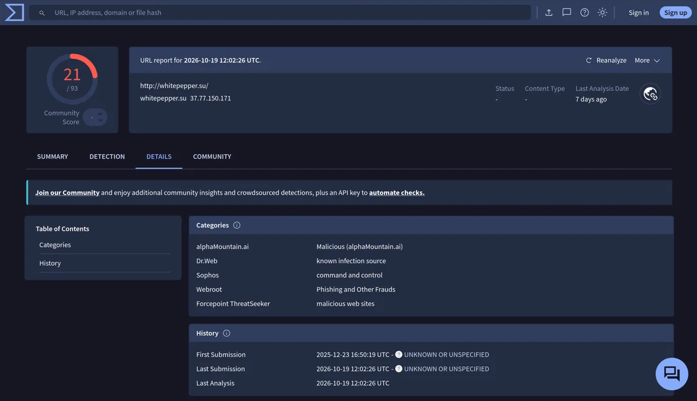
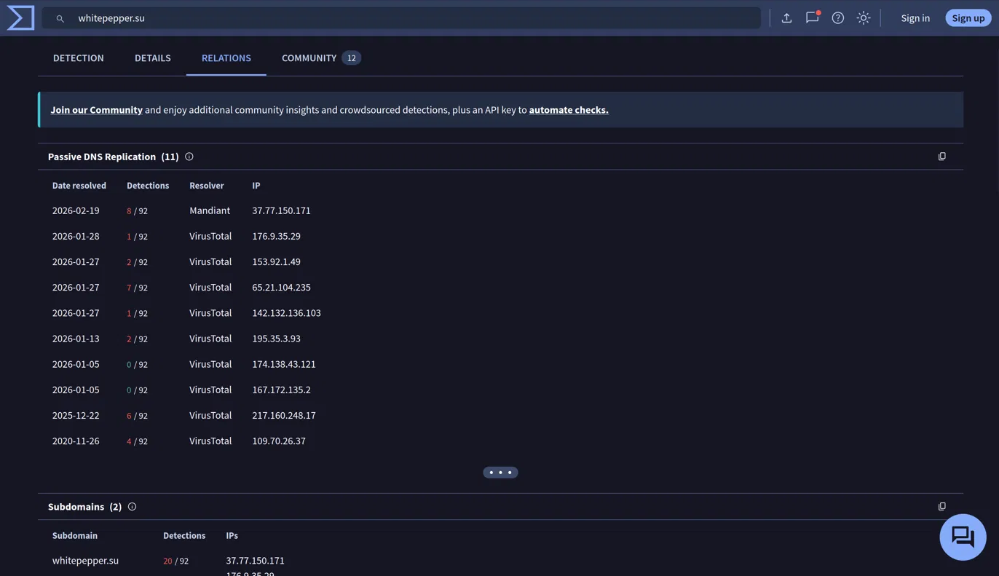
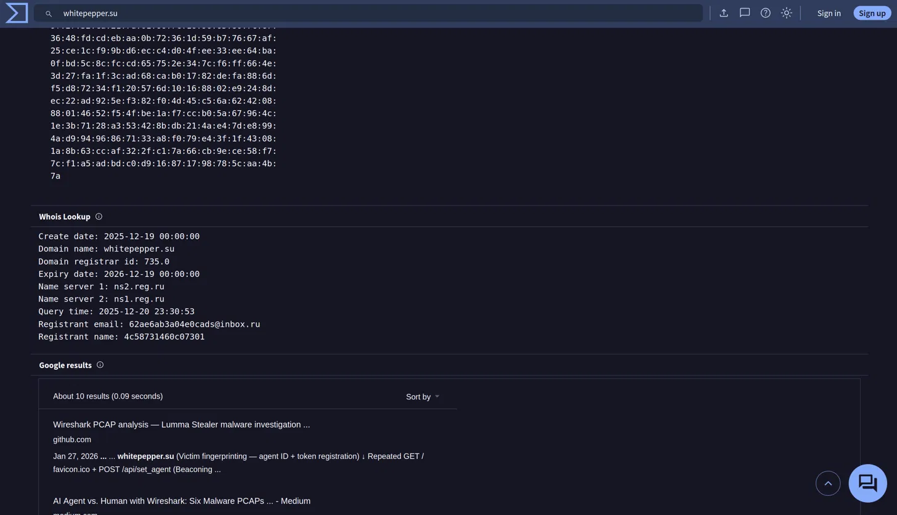

### Sample I studied: l72gk.exe
 
| Field | Value |
|---|---|
| SHA-256 | `05f43f12721ad343129545460f8af3caa7aa383aa9f026d5f104651d76fdfe08` |
| MD5 | `cfae758b84ea108c733088f8d0fcf22a` |
| Detections | 50/72 (last analyzed 2026-01-26) |
| Compiled | 2026-01-18 15:17 UTC (9 days before the capture) |
| First submitted | 2026-01-19 |
| Signed | No |
| VirusTotal tags | peexe, malware, long-sleeps, checks-bios, calls-wmi, detect-debug-environment, spreader, overlay |
 
This is one of 590 files that contact the domain. **My PCAP does not show this file on the victim**, so I treat it as context for the kind of malware that uses this server, not as the cause of this infection.
 
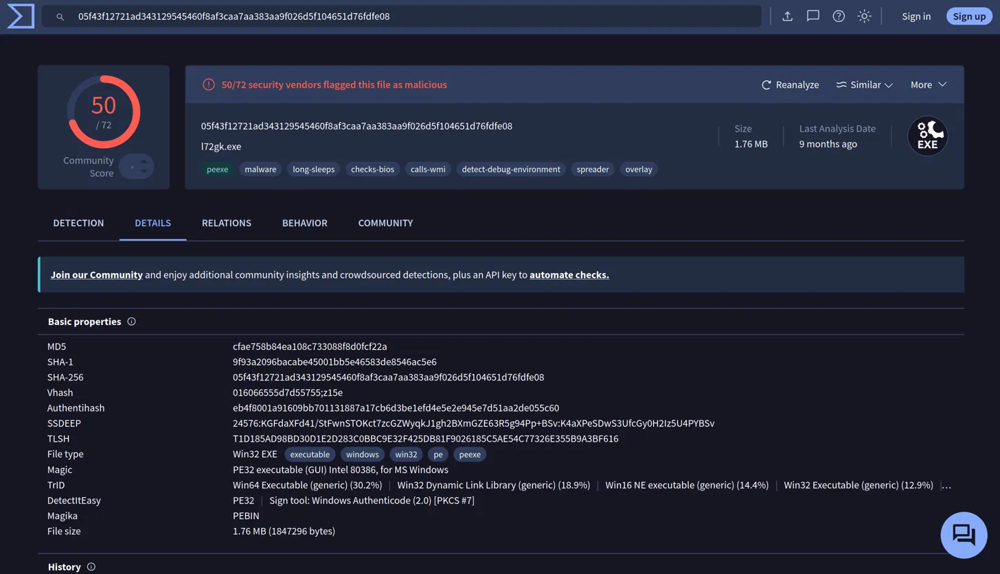

### ThreatFox Analysis
 
| Date (UTC) | IOC | Type | Family | Reporter |
|---|---|---|---|---|
| 2026-01-06 01:50 | hxxps://whitepepper[.]su/asds | n/a | Lumma Stealer (tag: Lumma) | abuse_ch |
| 2026-02-23 07:09 | hxxp://whitepepper[.]su/asds | n/a | Lumma Stealer | community user |

The `/asds` path matches the URL in the sandbox memory of `l72gk.exe`, which links that sample to the Lumma-labeled infrastructure. It differs from the `/api/set_agent` endpoint in my PCAP. ThreatFox is partly community-reported, so I treat these labels as "reported" and not "confirmed."
 
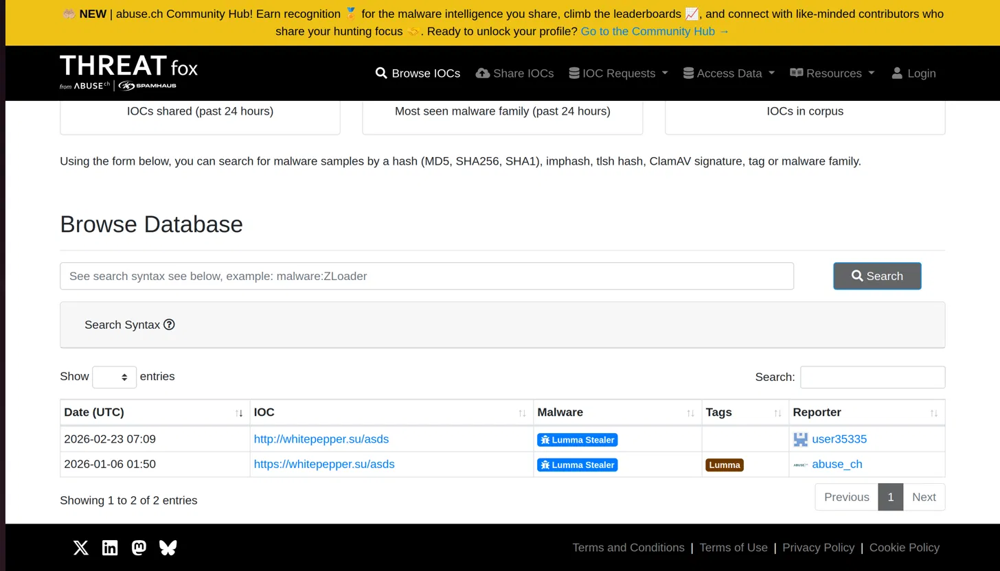

## IOCs (defanged)
 
| Indicator | Type | Where found | Notes |
|---|---|---|---|
| whitepepper[.]su | Domain | PCAP, packet 24500 | Registered 2025-12-19 |
| www[.]whitepepper[.]su | Domain | VirusTotal | Subdomain |
| whooptm[.]cyou | Domain | PCAP (DNS query), ThreatFox | Listed as Lumma C2; connection unverified |
| 153[.]92[.]1[.]49 | IP | Alert, PCAP | Resolution on 2026-01-27 |
| 37[.]77[.]150[.]171 | IP | VirusTotal | Latest as there's many URLhaus entries |
| 65[.]21[.]104[.]235, 142[.]132[.]136[.]103, 176[.]9[.]35[.]29 | IPs | VirusTotal passive DNS | Same-period |
| hxxp://whitepepper[.]su/api/set_agent | URL | PCAP | Fingerprinting check-in (GET/POST) |
| hxxp(s)://whitepepper[.]su/asds | URL | Sandbox memory, ThreatFox | Lumma Stealer per ThreatFox |
| hxxps://whooptm[.]cyou/api | URL | ThreatFox | botnet_cc, Lumma Stealer |
| `05f43f12...fdfe08` (full SHA-256 above) | File hash | VirusTotal | l72gk.exe |
| `6fd95f4a2d9cec238cbe2e1756890381c4fae3cb` | Cert thumbprint | VirusTotal | Self-signed `localhost`, first seen 2026-01-05 |
| `74531ebbf204e104d46cc486aa3f81b5b6a357d5` | Cert thumbprint | VirusTotal | Self-signed `localhost`, first seen 2025-12-15 |
| 10.1.21.58 / 00:21:5d:c8:0e:f2 / DESKTOP-ES9F3ML / gwyatt | Victim | PCAP | Internal, for responders |

## Infrastructure link graph📊
 
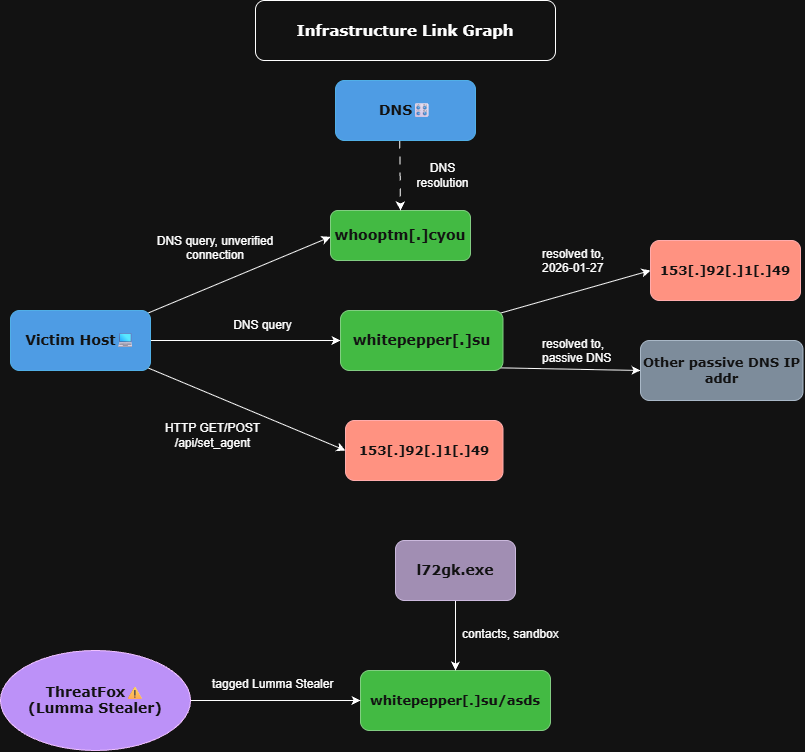

## MITRE ATT&CK mapping📌

| Tactic | Technique | Evidence type | Basis |
|---|---|---|---|
| Command and Control | T1071.001 Application Layer Protocol: Web Protocols | **Observed in my PCAP** | HTTP GET/POST to `whitepepper[.]su` (packets 24500, 24601, 25270, 25286) |
| Discovery | T1082 System Information Discovery | **Observed in my PCAP** | The POST body contains OS, hardware, and screen details (packet 24601) |
| Defense Evasion / Discovery | T1497 Virtualization/Sandbox Evasion | Sandbox, different sample (l72gk.exe) | VirusTotal behavior |
| Defense Evasion | T1027 Obfuscated Files or Information | Sandbox, different sample | VirusTotal behavior |
| Execution | T1047 Windows Management Instrumentation; T1129 Shared Modules | Sandbox, different sample | VirusTotal behavior |
| Discovery | T1057 Process Discovery | Sandbox, different sample | VirusTotal behavior |
| Collection | T1005 Data from Local System | Sandbox, different sample | VirusTotal behavior |
| Command and Control | T1095 Non-Application Layer Protocol; T1105 Ingress Tool Transfer | Sandbox, different sample | VirusTotal behavior |
| Credential Access | T1555.003 Credentials from Web Browsers | Expected for infostealers, **not observed** | Typical family behavior |
 
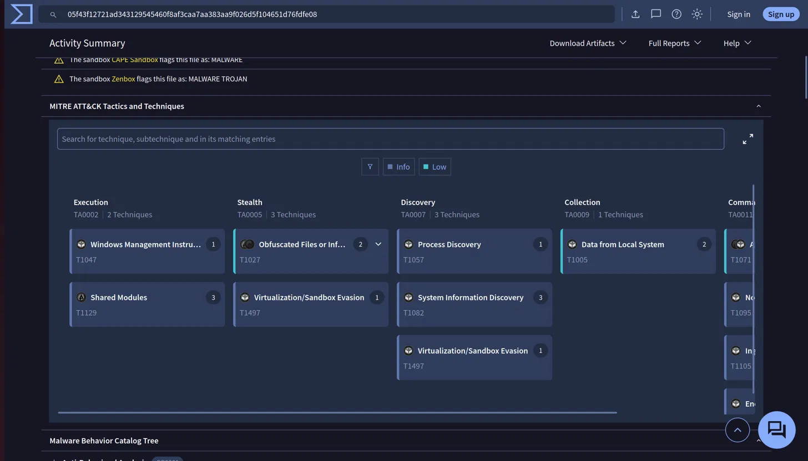

## How I would detect this🕵️
 
1. **Content match on the check-in:** alert on HTTP POSTs to `/api/set_agent` with `act=log` and a body containing `webgl=`, `canvas=`, and `fonts=` fields. A normal site does not post a full browser fingerprint to an API path like this.
2. **Domain age:** alert DNS or proxy logs with the registration date and flag domains younger than about 60 days (this one was 39 days old), especially on cheap or uncommon TLDs.
3. **Threat intel matching on DNS:** match DNS queries against feeds like ThreatFox.

## Limitations and open questions🛑
 
- I did not identify the initial infection from this capture. 
- What launched the browser request for the check-in page is unknown. The first GET has no `Referer` header, which only suggests it was opened directly.
- `whooptm[.]cyou` was queried by the host, but I did not verify a connection to it.
- `l72gk.exe` is not shown to be on the victim host.
- VirusTotal's domain detection counts are from October 2026, not from the capture date. The sample's 50/72 count is from 2026-01-26.
- ThreatFox attribution for `whitepepper[.]su` is for the `/asds` path, which differs from the path in my PCAP, and some entries are community-reported.
- Passive DNS gives dates only, so the order of the three same-day IPs is unknown.
- The PCAP covers one host, so I can't say whether the other hosts were affected.

## What I got wrong❌
 
I wrote my conclusions first and compared them with the published answers afterward.
 
- **Wrong reasoning for the infected IP.** I first pointed at TCP retransmission and overlap errors as signs of infection or injection. Those are common network noise. The real evidence is the alert's IP and timestamp plus the Conversations view showing a single internal host talking to it.
- **Missed the DNS lookup at first.** I wrongly concluded there was no lookup for `whitepepper[.]su`. There was one and my filter was wrong.

## References🖇️
 
- Exercise: malware-traffic-analysis.net, "Lumma in the Room-ah" (2026-01-31)
- VirusTotal, ThreatFox and URLhaus (abuse.ch), crt.sh, MITRE ATT&CK

